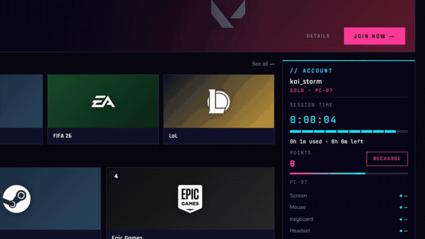
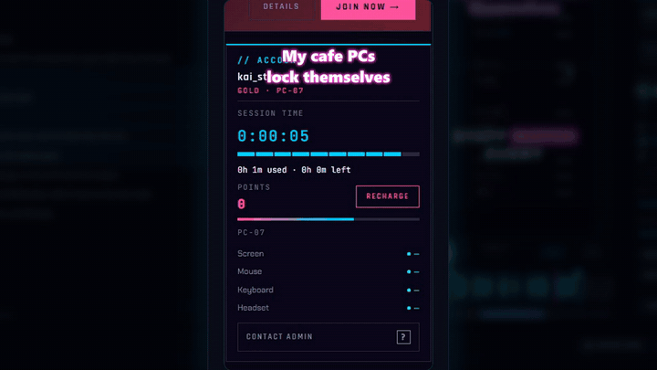
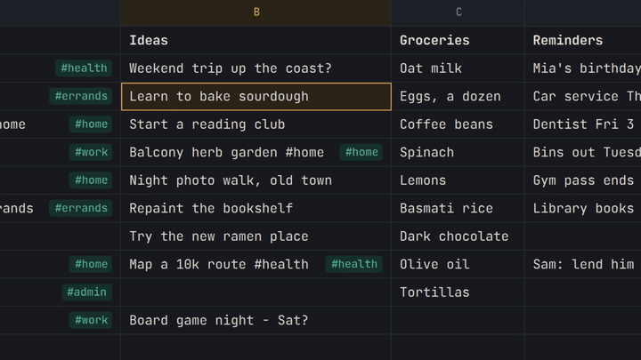
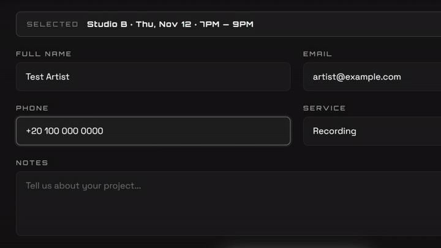
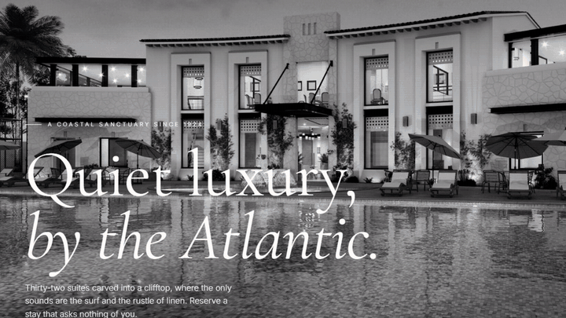

# MeGaA — Portfolio

Projects I designed and built with AI pair-programming (Claude Code): real desktop apps,
a client/server system, and front-end sites. Most of the Python is standard-library
only, with Qt Quick (PySide6 / QML) for the native, GPU-drawn UIs.

## Demo videos

Each video is the real app or site, recorded running (demo data, made-up names), then cut
with [HyperFrames](https://github.com/heygen-com/hyperframes). Click a preview for the full video.

<table>
  <tr>
    <td width="50%"><b>Vortex</b>: gaming-cafe system<br>
      <a href="media/vortex.mp4"></a><br>
      <a href="media/vortex.mp4">▶ Watch (39 s)</a></td>
    <td width="50%"><b>MeGaA Clipper</b>: long video in, short clips out<br>
      <a href="media/clipper.mp4"></a><br>
      <a href="media/clipper.mp4">▶ Watch (39 s)</a></td>
  </tr>
  <tr>
    <td width="50%"><b>GridPad</b>: a notepad laid out like a spreadsheet<br>
      <a href="media/gridpad.mp4"></a><br>
      <a href="media/gridpad.mp4">▶ Watch (34 s)</a></td>
    <td width="50%"><b>Ozone Studios</b>: studio booking site<br>
      <a href="media/ozone.mp4"></a><br>
      <a href="media/ozone.mp4">▶ Watch (34 s)</a></td>
  </tr>
  <tr>
    <td width="50%"><b>Voyago / Auriga</b>: travel and hotel templates<br>
      <a href="media/voyago-auriga.mp4"></a><br>
      <a href="media/voyago-auriga.mp4">▶ Watch (35 s)</a></td>
    <td width="50%"></td>
  </tr>
</table>

## Desktop apps

| Project | What it is | Stack |
|---|---|---|
| [**Vortex**](apps/vortex/) | Gaming-cafe management system (like Gizmo / iCafeCloud). A counter server sells time to members, every gaming PC runs a locked kiosk that launches games and locks itself when time runs out, and staff manage it all from a web admin panel. Includes a shop, events, pricing groups, and a Windows Server deployment kit. | FastAPI, SQLite, WebSockets, PySide6/QML kiosk, pywebview, PyInstaller |
| [**MeGaA Clipper**](apps/megaa-clipper/) | Turns long videos into vertical short-form clips with word-by-word captions, hooks, zooms, razor edits and loudness-normalised renders. Local GPU transcription; optional Claude-picked viral moments. | Python stdlib engine, whisper.cpp, ffmpeg/NVENC, web UI + QML edition |
| [**GridPad**](apps/gridpad/) | A notepad laid out like a spreadsheet: free-text cells, sheets as tabs, keyboard-first, themes. Two engines: Qt Quick (GPU) and classic Qt Widgets. | PySide6, QML |

## Websites

| Project | What it is |
|---|---|
| [**Ozone Studios**](web/ozone-booking/) | Booking site and admin panel for a recording studio in Cairo: per-room calendars, time slots, beat store, WhatsApp hand-off. Firebase Auth + Firestore. |
| [**Voyago / Auriga**](web/tourism-templates/) | Two travel and hospitality templates. |

## Screenshots

**Vortex**: the native kiosk client


**GridPad**: themes


## Running the projects

Each folder has its own README with setup steps. Quick versions:

```bash
# Vortex: server + admin panel at http://localhost:8787/admin/ (login admin / admin)
cd apps/vortex/server && pip install -r requirements.txt && python run_server.py

# GridPad
cd apps/gridpad && pip install -r requirements.txt && python gridpad_qml.py

# Websites: open the .html files, or
cd web/ozone-booking && python -m http.server 5174
```

## How I work

I plan each project with a five-step problem-solving lifecycle (analyze, plan, execute,
test, update), then build it iteratively with an AI coding agent: I make the product and
design decisions, the agent writes code, and I verify every feature with automated tests
and in the running app. Vortex's [PLAN.md](apps/vortex/docs/PLAN.md) and
[PROGRESS.md](apps/vortex/docs/PROGRESS.md) show that process end to end.
